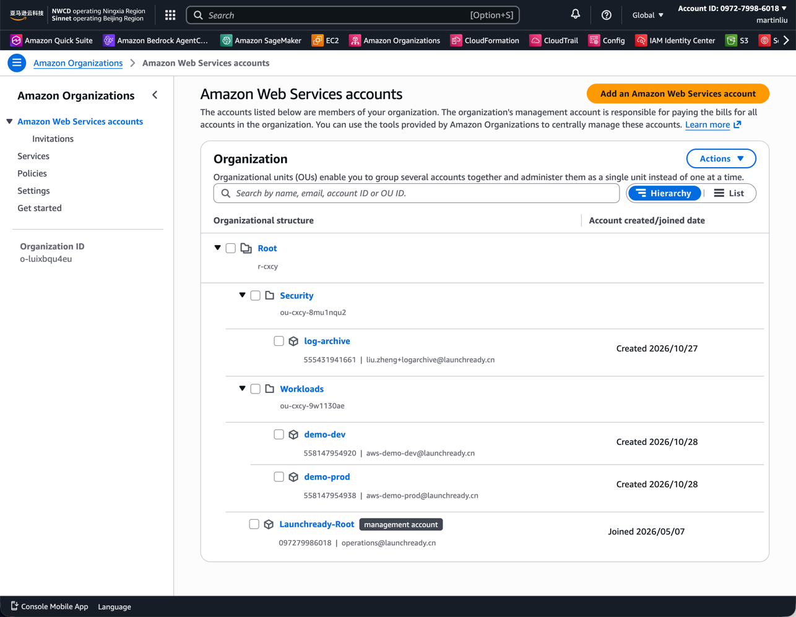
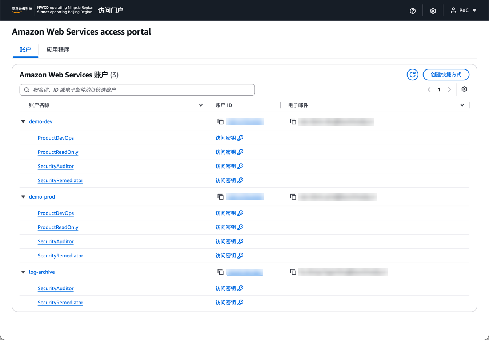
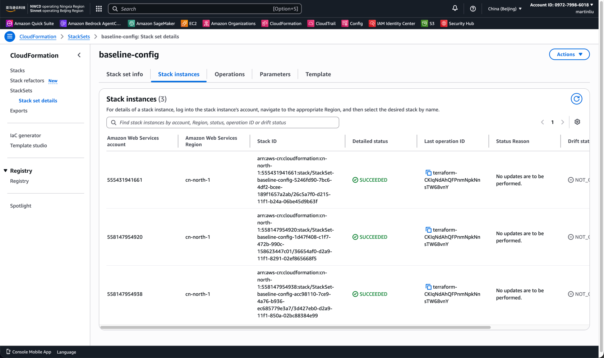
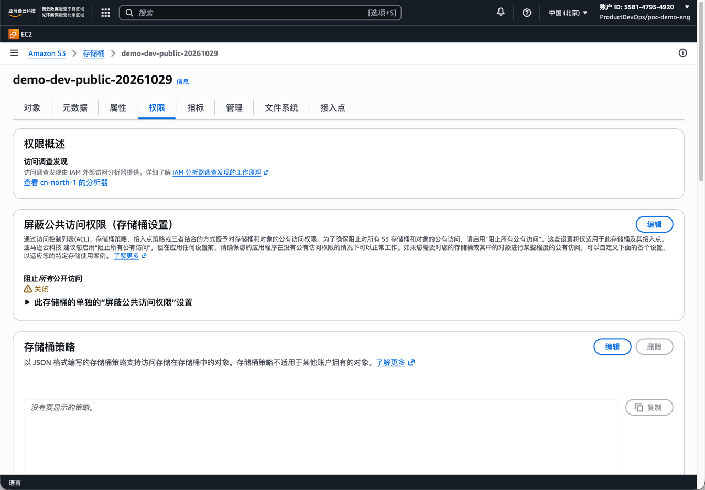
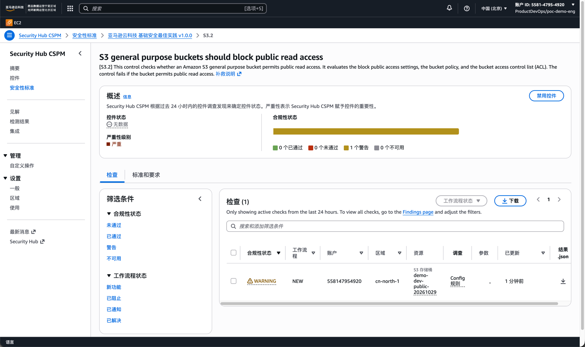
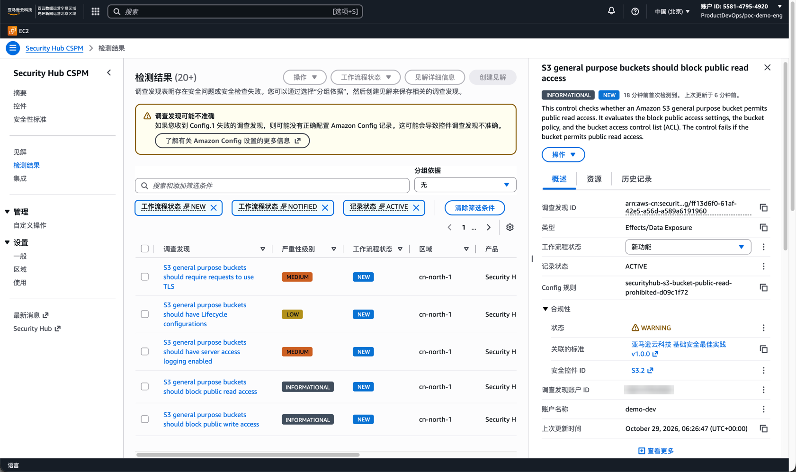

Need a multi-account baseline? On AWS Global, teams reach for Control Tower: guardrails, an account factory, a compliance dashboard, all managed. In the AWS China regions (Beijing cn-north-1, Ningxia cn-northwest-1), that road does not exist. Control Tower is absent from the supported-regions list, and AWS's own China blog stated in black and white in May 2025 that it "has not yet been launched in China Regions." No control catalog, no account factory, no compliance dashboard — the managed landing zone, as a product, simply does not exist on this partition.

So you build it yourself. The bigger nuisance is that most Chinese-language guides you can find online are obsolete: several key capabilities only landed in 2023, and older articles still teach you to work around "China has no SCPs" — a problem that no longer exists.

This article is the complete record of my own build from scratch: one organization, one central log-archive account, a two-account product team vended by pipeline, identity unified through IAM Identity Center, guardrails as SCPs, baselines pushed by StackSets, and the whole thing accepted with a closed compliance loop — violation → detection → least-privilege remediation → verified recovery. Every number in this article came out of my own accounts, including the parts that failed on the first try.

If you have read the previous article, [AWS China in Practice: The Real Gaps Beyond the Service Catalog](/blog/aws-china-region-gap-beyond-catalog/), this is its hands-on sequel: that one measured where the gaps are, this one builds the baseline underneath them.

## The Foundation You Actually Have

Start by counting the cards in your hand. The result runs against most expectations: the primitives are all there, just surprisingly recent.

| Capability | Available in China since | Notes from this build |
| --- | --- | --- |
| AWS Organizations (OUs, consolidated billing, CreateAccount) | Jun 2020 | Worked as documented; the default account quota is the surprise (below) |
| CloudFormation StackSets, service-managed with OU auto-deploy | Apr 2023 | The auto-deploy promise held — accounts entering an OU get the baseline, zero manual steps |
| IAM Identity Center | Sep 2023 | The full Terraform surface works; portal on `awsapps.cn` |
| Service Control Policies | Oct 2023 | Pre-2023 guides telling you to work around missing SCPs can go in the bin |

Two absences define the project. The first is Control Tower itself. The second is the set of replacements you might use globally: the legacy AWS Landing Zone solution is dead, and the AWS Secure Environment Accelerator is bound to Control Tower. The one official alternative AWS names for China is **Cloud Foundations** — an open-source solution you deploy and operate yourself; AWS's China blog explicitly positions it as usable in the regions in the modes that do not depend on Control Tower. Note what it is, though: an accelerator, not a substitute. Deployment, upgrades, and drift are all yours. I chose to build a thin version by hand, for one simple reason: only then can every layer be measured.

## Target Shape

I kept the build down to four accounts, three organizational units, one identity source:



- **Management account** — organizations, SCPs, billing only. Business workloads never enter this account.
- **Security OU / `log-archive`** — the audit and aggregation seat: delegated Security Hub administrator, future Config aggregator, home of the central evidence.
- **Workloads OU / `demo-dev`, `demo-prod`** — one product team, vended by pipeline; every future product lands here as another pair.

The identity layer rides an existing IAM Identity Center instance (its identity store, not an external IdP). Groups are provisioned per product — `poc-demo-devops`, `poc-demo-readers` — plus `poc-auditors` and `poc-platform-admins`. Where day-to-day governance actually lives is the permission-set matrix:

| Permission set | Power | Session | Bound to |
| --- | --- | --- | --- |
| ProductDevOps | PowerUserAccess plus IAM self-service | 8 h | the product's devops group, dev + prod |
| ProductReadOnly | View-only | 8 h | same group, for day-0 onboarding |
| SecurityAuditor | SecurityAudit managed policy (read-only) | 4 h | auditors group, every account |
| SecurityRemediator | Inline policy: S3 public-access remediation only | 1 h | auditors group, every account |
| BreakGlassAdmin | AdministratorAccess, constrained by SCPs | 1 h | platform admins, one account |

Two China-specific notes on identity. The good side: the portal and CLI experience is nearly identical to Global — `awsapps.cn/start`, `aws sso login` against `oidc.cn-north-1.amazonaws.com.cn`, the same 1 h default / 12 h maximum permission-set sessions. The bad side: Identity Center in China has **no multi-region replication** (the 2026 global feature covers 17 commercial regions, none of them here). So a break-glass path that does not depend on the portal is not nice-to-have hardening — it is the difference between an outage and an incident.



## Vending a Product Team

How does a new team arrive? One YAML file, one `terraform apply`:

```yaml
# products/demo.yaml
name: demo
email_prefix: aws          # aws-demo-dev@<domain>, aws-demo-prod@<domain>
environments: [dev, prod]
cidr: 10.60.0.0/16         # recorded for the pipeline; no VPC at this stage
groups:
  devops: poc-demo-devops
cost_center: POC-DEMO-001
```

A `for_each` over `products/*.yaml` expands the file into accounts in the Workloads OU, per-product groups and users in Identity Center, and the account assignments that bind permission sets to groups. Measured wall clock:

| Step | Measured |
| --- | --- |
| Each member account creation (3 accounts observed) | **12 seconds** |
| Each permission-set account assignment | 26 s, parallelizable |
| One full vend (2 accounts + 6 assignments) | **45 s total** |
| Baseline StackSet auto-deploy into the new accounts | ~2 min to fully deployed, zero manual steps |

Twelve seconds to create an account, forty-five to vend a whole team — the number I am most satisfied with in this entire build.

The same run hit two gotchas. First: assigning against an account that is seconds old fails with `InvalidClientTokenId`. The cause is not a configuration error — Identity Center provisions a role inside the new account and can beat the account's own credential propagation. Wait 30 seconds, retry, success in 11 s. The lesson fits in one line: your pipeline must build that retry in. Second is the account quota — and the project's first "mine you discover on load-test day": a fresh China organization can create exactly **two accounts** (management plus one member); the third fails outright with `You have exceeded the allowed number of AWS accounts`. There is no self-service path — Organizations has no Service Quotas entries in this partition at all, so the only route is an AWS China support case. Mine was approved within a day, but any real multi-account program should put that ticket on day one of the plan.

The baseline new accounts receive is a service-managed StackSet targeting the OUs with auto-deployment on — the closest thing this partition has to Account Factory's baseline step:



## Guardrails and the Organization Trail

Three SCPs cover the shape: a root-level **deny on `organizations:LeaveOrganization`** — once an account joins, nobody inside it can walk out; I negative-tested this from a member account; a root-level **region deny** to cn-north-1/cn-northwest-1 with the usual global-service exemptions; and a Workloads-OU guardrail protecting the audit trail (`cloudtrail:StopLogging`, `config:DeleteConfigurationRecorder` and friends).

Organization-wide CloudTrail exposed a genuine China-partition difference, and the most subtle one in the project. The global documentation writes the organization-trail bucket policy resource as `AWSLogs/<org-id>/*` — copy that, and the CreateTrail validator here rejects it outright. The version the validator accepts must **also include** `AWSLogs/<management-account-id>/*`. Hang both prefixes on the central bucket and creation succeeds; the object listing then explains why: the management account's log paths exist under both forms. In one sentence: the documentation does not lie to you, but it does not tell you the whole story either. With multi-region validation on, the trail writes all four accounts' logs into one bucket (hundreds of objects per account within the first day), readable organization-wide, including as a read-only entry in each member account's CloudTrail console.

## The Config Bootstrap Chain

The most instructive failure of the build. The first baseline template did the obvious thing — an IAM role, a Config recorder, a delivery channel, two managed rules — and failed; revise, fail again; revise again, still fail. The root causes of all three, each verified:

1. **A recorder without a delivery channel will not start.** `start-configuration-recorder` returns `NoAvailableDeliveryChannelException`. In this partition the channel is not optional furniture; it is a precondition.
2. **The central bucket policy must grant Config write by account-ID list.** An `aws:PrincipalOrgID` condition — the pattern CloudTrail is perfectly happy with — leaves Config unable to write (`InsufficientDeliveryPolicyException`). `aws:SourceAccount` with the member account IDs works. That policy is now generated from the live account list, so new accounts are covered automatically.
3. **A role created milliseconds earlier falls over on IAM propagation at the channel check** (`unable to assume role`) — a 20-second retry clears it.

The working recipe: assume the member role → create the recorder role → `put-configuration-recorder` → `put-delivery-channel` pointing at the central bucket → `start`, with retries on the middle steps. One script holds it; all three accounts were recording within three minutes.

The lesson generalizes. Behind every detective control in China hides a bootstrap chain that Control Tower's ConfigBaseline would have owned for you. Your baseline repository is not boilerplate; it is load-bearing infrastructure, with failure modes of its own.

## Detective Controls at Organization Scale

Security Hub in China supports organization mode with a delegated administrator. Two hard rules: the delegated administrator **must be a member account** (mine is `log-archive`), never the management account; and **auto-enable only affects accounts that join the organization later** — accounts that already existed must be added explicitly via CreateMembers before the delegated administrator can see them. Compared with Control Tower's global auto-enrollment, that is exactly the missing step, so write it into the runbook.

Standards subscribe per account. The China catalog lists a dozen or so, including AWS Foundational Security Best Practices and the CIS benchmarks; member accounts pick up the defaults as they are associated.

And one sequencing dependency the console will not show you — until it bites: **most FSBP controls will not evaluate without a Config recorder in the account**. Subscribe without a recorder and the status sits at `INCOMPLETE` with reason `NO_AVAILABLE_CONFIGURATION_RECORDER`. Config first, Security Hub second. Get the order backwards and you will stare at a wall of unexplained yellow on the dashboard.

## The Compliance Loop, Measured

I set the acceptance criteria before building: an engineer makes a mistake, the audit function sees it from another account, fixes it with scoped permissions, and the engineer watches compliance recover. Four steps, all screenshotted.

**Step 1 — the violation.** Signed in as `ProductDevOps` on `demo-dev`, the engineer creates a bucket and leaves it public-read:



**Step 2 — detection.** Minutes later (the finding page showed "updated 1 minute ago" on first view), FSBP control S3.2 flips:



The same finding, seen from where an auditor actually works — the delegated-administrator account:


**Step 3 — remediation, least privilege.** The auditor switches to `SecurityRemediator` — the 1-hour permission set whose inline policy allows exactly the S3 public-access-block actions and nothing else — and enables Block Public Access on the bucket. From the same session I deliberately tried to delete the bucket. Denied — which is the design intent: the audit function can fix this one class of finding and nothing else.

**Step 4 — verified recovery.** Config records the change, the control re-evaluates, S3.2 returns to green, and the finding's workflow moves to `RESOLVED` — confirmed by the engineer from the ProductDevOps session, same portal, different role. Detection to resolution in minutes, not days, the whole chain visible to three different permission sets, no shared credentials.



## AI Agents and Automation Workloads

This stack was designed for human engineers, but its biggest beneficiaries are the "non-human engineers": AI agents, CI/CD pipelines, IaC automation, ChatOps bots. What they share: code that calls APIs autonomously at machine speed, with nobody vetting each call — the permission boundary is the only security boundary there is. An attacker in the prompt-injection era does not even need to steal credentials; they just have to trick an agent into making one API call with the credentials it already holds. Locking each agent and each toolchain into its own account is the hardest blast-radius control available — and that is precisely the vending pipeline's day job: add an `ai-agent.yaml` or `cicd.yaml` to `products/*.yaml`, and 45 seconds later a machine account with the full baseline, SCP guardrails, and audit aggregation is in place, at the same compliance starting point as a human team.

First, existence: the foundation for machine workloads in China exists — SageMaker is available, and Bedrock AgentCore has launched in the China regions; its Identity component issues short-lived credentials to agents via workload identity and a token vault, isomorphic to the governance here (Bedrock itself being absent affects the model-hosting layer, not the identity-governance layer). The more important point is that **this account system is decoupled from the runtime**: whether the agent runs on AgentCore, SageMaker, or self-managed containers, whether the pipeline comes from GitHub Actions, Jenkins, or an internal scheduler, every call they make against AWS resources lands on IAM credentials and passes through the SCP gate. Three onboarding patterns by workload:

- **AI agents**: one account per agent (or per class of agents), the capability surface defined by IdC permission sets or IAM roles, the runtime exchanging short STS sessions through a role chain (15 minutes minimum) with session tags `agent-id` / `task-id` — every API call in CloudTrail is attributable to a specific agent on a specific task, not to one faceless shared identity.
- **CI/CD pipelines**: deploy jobs use OIDC federation or a self-hosted runner's instance profile to assume a role in the target account, credentials never touching disk; each pipeline gets its own role, so who deployed what to which account and when is queryable call by call in CloudTrail.
- **IaC automation**: Terraform state and execution live in a dedicated automation account, `apply` runs under a short-session role, and unplanned drift is caught by Config — the drift-check inspection that accompanies this article runs exactly this way, inside the system.

Once machine accounts are onboarded, monitor their behavior like this:

1. **Trail retention**: the organization-wide CloudTrail from this article already centralizes every account's events into log-archive; turn on data events (off by default) for agent model invocations and toolchain credential reads — those are the actions that otherwise never make it into the audit trail.
2. **Anomaly detection**: GuardDuty has been available in China since 2021, with two realities you must know: organization-management policies are currently unavailable in the China regions, so enablement is a per-account script; and AI workload protection is partial — `AnomalousModelInvocation` and `CostHarvesting` findings work because they rely on SageMaker invocation patterns, while `PromptInjection.Direct` is unavailable because Bedrock is absent. Machine-workload detection in China means these available signals plus your own rules filling the gaps.
3. **Aggregation and response**: the Security Hub delegated administrator (already configured in this article) aggregates findings from every machine account; the S3 compliance loop above applies verbatim when an agent or a pipeline makes the mistake — detection, least-privilege remediation, verified recovery, closed in minutes.

Why the IAM-user AK/SK route should be banned outright for machine workloads — one table says it:

| Dimension | IAM User AK/SK | IdC permission sets + STS temporary credentials |
| --- | --- | --- |
| Credential lifetime | Valid forever, until manually rotated | 15 min – 12 h, auto-expires |
| Breach impact | Unlimited exposure window, until a human notices and disables | Window = session length, self-destructs on expiry |
| Attribution | All calls share one username; which agent, which task — indistinguishable | Sessions carry agent-id/task-id; per-call attribution |
| Permission governance | Inline policies scattered across accounts, drift invisible | Permission sets defined centrally; one change, org-wide effect |
| Guardrail layering | No additional constraint layer | SCP + permission boundary + session policy, three-layer narrowing |
| Rotation cost | Manual process; in practice, never | No rotation needed — credentials are born short-lived |

Every row of that table is amplified for machine workloads: machine credentials are embedded in code and config, with an exposure surface far larger than a human user's; machine call volume is high, making anomalies harder to catch by eye; machine incidents need responsibility traced to the agent or pipeline level. AK/SK leaves all three problems for humans to catch; IdC + STS turns them into architecture properties. In one sentence: the value of this system for AI agents and DevOps automation toolchains is right there in those rows.

## What This Stack Still Is Not

Let me state the ceiling plainly, because the gap is structural, not cosmetic. Control Tower on Global ships a catalog of 750+ AWS-maintained controls (preventive SCP sets, detective Config and Security Hub rules, proactive CloudFormation-hooks controls) with versioning and deprecation handled by AWS; a compliance dashboard with drift detection, de-duplicated notifications, and one-click reset; an Account Factory with identity assignment wired at vend time; and an IaC surface with landing-zone semantics.

We reproduced what can be reproduced, and reproduced it well: the vending flow is genuinely close, the region deny is a one-hour SCP, the end-user portal experience is nearly identical, and the compliance loop above is real. **What has no equivalent is the content and the governance UX** — every rule, every runbook, every upgrade is your team's backlog forever. Proactive controls (CloudFormation Hooks) and resource control policies have no documented China availability at all; treat them as absent until proven otherwise.

In one sentence: the architecture can be cloned; the governance content and the governance UX are yours. The realistic posture: a curated set of 20–50 controls you own personally, with the residual risk written down.

## The Gotchas List

For anyone doing this build, the full toll in the order you will meet it:

1. **Account quota = 2 by default.** Support case, not Service Quotas. Budget a day.
2. **The SCP policy type may need enabling** before your first policy attaches — one CLI call, but it fails confusingly if skipped.
3. **One statement cannot carry both `Action` and `NotAction`** — SCP validation here is strict about it.
4. **Service-managed StackSets trust access can only be granted by the console toggle.** The documented CLI principal (`cloudformation.amazonaws.com`) returns `UNRECOGNIZED_SERVICE_PRINCIPAL` on this partition; the one the API accepts does not flip CloudFormation's switch. One manual click, once — plus one paragraph in your runbook.
5. **Organization-trail bucket policies need both prefixes** (`AWSLogs/<org-id>/*` and `AWSLogs/<management-account-id>/*`) or CreateTrail rejects them.
6. **Config needs role + recorder + delivery channel + start, with retries** — the three root causes above.
7. **Security Hub org mode**: delegated admin must be a member account; auto-enable covers only future accounts; `NO_AVAILABLE_CONFIGURATION_RECORDER` means your Config step regressed.
8. **Identity Center has no multi-region replication in China.** Design break-glass that does not depend on the portal.
9. **The org bill ignores your OU structure.** Chargeback rides tags and CUR, as globally — but with RMB-only settlement and per-operator (Sinnet Beijing / NWCD Ningxia) contracts, product-line invoicing needs to be on the table earlier.

## Cost and Repeatability

At this footprint — four accounts, Config everywhere, Security Hub with default standards, one organization trail — the monthly cost is single-digit US dollars; Security Hub's per-finding ingestion is negligible at this volume, and CloudTrail management events are free. The environment is deliberately kept as a repeatable demo: the same `products/*.yaml` flow that vended the demo team vends the next one, and a reset script walks the full teardown path. The expensive input is not the AWS bill — it is the engineering time the first build burns on items 1–8 above. Shrinking that number is what this article exists for.

## FAQ

**Is Control Tower available in the AWS China regions?**
No. It is absent from the supported-regions list, the China documentation site has no Control Tower section, and AWS's own May 2025 China blog says it "has not yet been launched in China Regions." For a landing zone, build it yourself with Organizations, IAM Identity Center, StackSets, and Terraform — this article is the measured walk-through of that build.

**How many accounts can a new China organization create?**
In my build, the default ceiling was two (management + one member). Raising it takes an AWS China support case; Organizations has no Service Quotas entries in the China partition. My increase to ten accounts was approved within a day — but plan the ticket for day one.

**Does Terraform work against the AWS China partition?**
Yes, end to end. The hashicorp/aws provider (v6.70.0 in this build) managed Organizations, SCPs, Identity Center, permission sets, account assignments, and service-managed StackSets without partition-specific workarounds. What needed fixing were provider-version schema details and service-side bootstrap order — never the partition itself.

**Is there an official alternative?**
One — AWS Cloud Foundations, an open-source self-deployed solution. AWS's China blog positions it as usable in the China regions in the modes that do not depend on Control Tower. It saves build time, but deployment, upgrades, and drift remain yours; the governance content and governance-UX gaps Control Tower would have filled remain yours too.

## Sources

- [AWS Control Tower supported regions](https://docs.aws.amazon.com/controltower/latest/userguide/region-how.html) — no China regions listed
- [AWS China blog — manage Control Tower with Cloud Foundations (May 2025)](https://aws.amazon.com/cn/blogs/china/manage-control-tower-with-cloud-foundations-govern-regions-manage-organizations-create-or-enroll-accounts-enable-controls-en/) — the "not yet launched in China Regions" statement and the Cloud Foundations positioning
- [IAM Identity Center available in China regions (Sep 2023)](https://www.amazonaws.cn/new/2023/amazon-iam-identity-center-is-available-in-amazon-web-services-china-regions)
- [Service control policies in China regions (Oct 2023)](https://www.amazonaws.cn/new/2023/amazon-organizations-supports-service-control-policies-in-amazon-web-services-china-regions)
- [CloudFormation StackSets GA in China regions, service-managed (Apr 2023)](https://www.amazonaws.cn/new/2023/amazon-cloudformation-stacksets-in-china-regions)
- [AWS China blog — automated account creation practice (2024)](https://aws.amazon.com/cn/blogs/china/practice-of-automated-account-creation-on-the-cloud/)
- [Getting started with AWS services in China — official user guide PDF](https://docs.amazonaws.cn/aws/latest/userguide/aws-ug.pdf) — the authoritative per-service China differences document
- [AWS China FAQ — accounts, real-name verification, operators, RMB settlement](https://www.amazonaws.cn/about-aws/china/faqs/)

For more measured gaps between China and Global (version, features, quotas, experience, cost — five dimensions), see the [Chinaready parity tracking page](/chinaready/).


