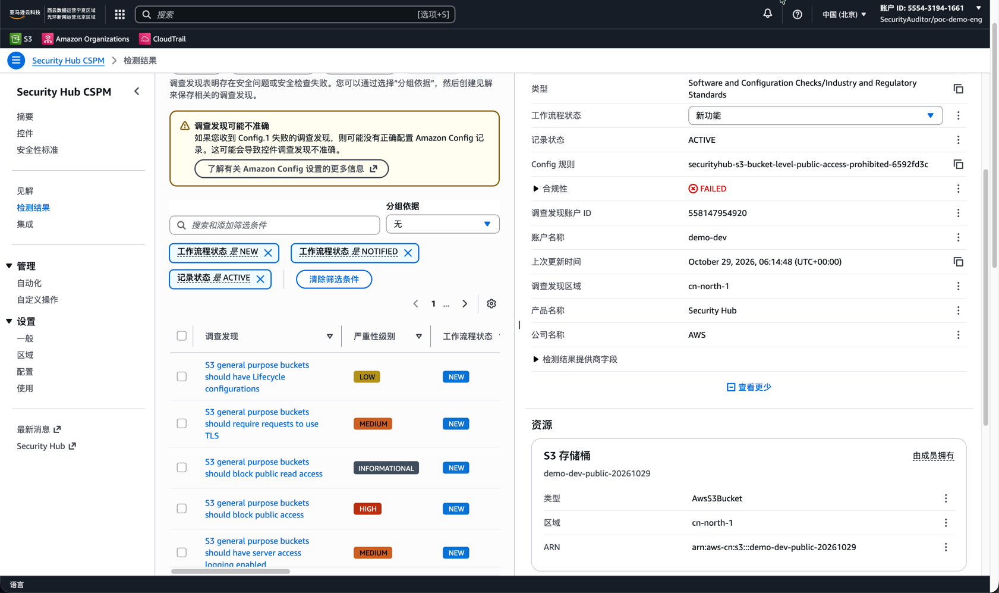

要做多账号基线，国际区的团队伸手就用 Control Tower：护栏、账号工厂、合规看板，全是托管的。到了 AWS 中国区（北京 cn-north-1、宁夏 cn-northwest-1），这条路不存在。Control Tower 不在支持区域列表里，AWS 官方中国区博客 2025 年 5 月白纸黑字写着「尚未在中国区发布」。没有护栏目录，没有账号工厂，没有合规看板——托管 landing zone 这个产品，在中国区就是没有。

所以只能自己搭。更麻烦的是，网上能搜到的中文攻略大多已经过时：好几个关键能力是 2023 年才落地的，老文章还在教你绕开「中国区没有 SCP」这种早就不存在的问题。

这篇文章是我自己一次从零搭建的完整记录：一个组织、一个中央日志归档账号、一条流水线开出来的双账号产品团队、IAM Identity Center 统一身份、SCP 护栏、StackSets 推基线，最后用一条「违规 → 检测 → 最小权限修复 → 验证恢复」的合规闭环验收全部。文中每个数字都出自我自己的账号，包括那些第一次就失败的部分。

如果你读过上一篇 [《AWS 中国区实战：与国际区服务目录之外的真实差距》](/blog/aws-china-region-gap-beyond-catalog/)，这篇是它的落地续篇：上篇讲差距在哪，这篇讲差距之下基线怎么搭。

## 可用地基

先盘点中国区手里有什么牌。结果和大多数人的预期相反：原始能力都在，只是很多新得出人意料。

| 能力 | 中国区可用时间 | 本次实测备注 |
| --- | --- | --- |
| AWS Organizations（OU、合并账单、CreateAccount） | 2020 年 6 月 | 与文档一致；默认账号配额是个惊喜（见下文） |
| CloudFormation StackSets（服务托管 + OU 自动部署） | 2023 年 4 月 | 自动部署承诺成立——账号进 OU 即得基线，零手工 |
| IAM Identity Center | 2023 年 9 月 | Terraform 全量面可用；门户在 `awsapps.cn` |
| 服务控制策略（SCP） | 2023 年 10 月 | 2023 年前教你绕开 SCP 的攻略可以扔了 |

真正定义这个项目的是两个缺席。第一个是 Control Tower 本体。第二个是国际区的替代品们：老 AWS Landing Zone solution 已死，AWS Secure Environment Accelerator 绑死 Control Tower。AWS 官方给中国区点名的唯一替代是 **Cloud Foundations**——一个开源自部署方案，AWS 中国区博客明确说它在中国区可用于不依赖 Control Tower 的模式。但注意，它是加速器不是替身：部署、升级、漂移全归你自己管。我最后选择手工搭一个薄版本，原因很简单：只有这样，每一层才能被测量。

## 目标形态

我把这次搭建收在四个账号、三个 OU、一个身份源：


- **管理账号**——只放 Organizations、SCP、账单。业务负载永远不进这个账号。
- **Security OU / `log-archive`**——审计与聚合席：Security Hub 委托管理员、未来的 Config 聚合器、中央证据都落在这。
- **Workloads OU / `demo-dev`、`demo-prod`**——一个产品团队，流水线开箱；未来每个产品都作为一对新账号落在这里。

身份层复用既有 IAM Identity Center 实例（用它的身份源，不接外部 IdP）。按产品建组——`poc-demo-devops`、`poc-demo-readers`，另有 `poc-auditors` 和 `poc-platform-admins`。日常治理真正落地的地方是权限集矩阵：

| 权限集 | 权限 | 会话时长 | 绑定 |
| --- | --- | --- | --- |
| ProductDevOps | PowerUserAccess + IAM 自服务 | 8 小时 | 产品 devops 组，dev + prod |
| ProductReadOnly | 只读 | 8 小时 | 同组，入职第一天用 |
| SecurityAuditor | SecurityAudit 托管策略（只读） | 4 小时 | 审计组，全部账号 |
| SecurityRemediator | 内联策略：仅 S3 公开访问修复 | 1 小时 | 审计组，全部账号 |
| BreakGlassAdmin | AdministratorAccess，受 SCP 约束 | 1 小时 | 平台管理员，单账号 |

身份层有两个中国区特有的点。好的一面：门户和 CLI 体验与国际区几乎一致——`awsapps.cn/start`、`aws sso login` 对着 `oidc.cn-north-1.amazonaws.com.cn`，权限集会话同样 1 小时默认、12 小时上限。坏的一面：中国区的 Identity Center **没有多区域复制**（2026 年那个全球新特性覆盖 17 个商业区域，不含中国）。所以「不依赖门户的破窗路径」不是锦上添花——它是有事故和有事变的区别。


## 产品团队开箱

新团队怎么进来？一个 YAML 文件，一次 `terraform apply`：

```yaml
# products/demo.yaml
name: demo
email_prefix: aws          # aws-demo-dev@<domain>, aws-demo-prod@<domain>
environments: [dev, prod]
cidr: 10.60.0.0/16         # 只登记给流水线；此阶段不建 VPC
groups:
  devops: poc-demo-devops
cost_center: POC-DEMO-001
```

一个 `for_each` 遍历 `products/*.yaml`，把文件展开为 Workloads OU 里的账号、Identity Center 里的产品组和用户、以及权限集到组的账号分配。实测耗时：

| 步骤 | 实测墙钟时间 |
| --- | --- |
| 单个成员账号创建（观测 3 个账号） | **12 秒** |
| 单条权限集账号分配 | 26 秒，可并行 |
| 一次完整开号（vend：2 账号 + 6 分配） | **合计 45 秒** |
| 基线 StackSet 自动部署进新账号 | 约 2 分钟全量部署，零手工步骤 |

45 秒开一个团队，这是整个实测里我最满意的数字。

同一轮实测里还撞了两个坑。第一个：对创建仅数秒的账号做分配，报 `InvalidClientTokenId`。原因不是配置错——Identity Center 要在新账号里预置一个角色，跑赢了账号自身的凭证传播。等 30 秒重试，11 秒成功。教训就一条：你的流水线必须内置这个重试。第二个就是账号配额，也是全项目第一个「压测日才发现的地雷」：全新的中国区组织默认只能建 2 个账号（管理账号 + 1 个成员），第三个直接报 `You have exceeded the allowed number of AWS accounts`。提额没有自助通道——Organizations 在这个分区连 Service Quotas 条目都没有，只能提 AWS 中国区工单。我的工单一天批了，但任何真实的多账号项目，第一天就该把这张票排进计划。

新账号拿到的基线是一个服务托管 StackSet，目标 OU、自动部署开启——这是该分区最接近 Account Factory 基线步骤的东西：


## 护栏与组织日志

三个 SCP 覆盖住基本盘：根级**拒绝 `organizations:LeaveOrganization`**——账号一旦加入，谁也休想从里面退群，这条我从成员账号做过反向验证；根级**区域拒绝**，只放 cn-north-1 / cn-northwest-1 外加常规全局服务豁免；Workloads OU 级**审计轨迹保护**（`cloudtrail:StopLogging`、`config:DeleteConfigurationRecorder` 一族）。

组织级 CloudTrail 这里暴露了一个货真价实的中国分区差异，也是全项目最隐蔽的一个坑。国际区文档给组织追踪桶策略写的资源是 `AWSLogs/<org-id>/*`——照抄，CreateTrail 校验器直接拒绝。校验器接受的版本必须**同时包含** `AWSLogs/<management-account-id>/*`。两个前缀都挂上，创建成功；对象列表随即说明原因：管理账号的日志路径两种形式下都存在。一句话：文档没骗你，但也没把话说全。开多多区域校验后，这条追踪把四个账号的日志全部写进一个桶（首日每账号数百对象），组织内可读，每个成员账号的 CloudTrail 控制台里也有只读入口。

## Config 引导链

整个搭建里最有教学价值的失败。第一版基线模板做了最显然的事——一个 IAM 角色、一个 Config 记录器、一个投递通道、两条托管规则——失败；改，再失败；再改，还失败。三次的根因，逐条验证过：

1. **没有投递通道的记录器起不来。** `start-configuration-recorder` 直接 `NoAvailableDeliveryChannelException`。在这个分区，通道不是可选配件，是前置条件。
2. **中央桶策略必须按账号 ID 列表授权 Config 写入。** 用 `aws:PrincipalOrgID` 条件——CloudTrail 皆大欢喜的模式——Config 就是写不进去（`InsufficientDeliveryPolicyException`）。换成 `aws:SourceAccount` 加成员账号 ID 列表就通了。这份策略现在从活跃账号列表自动生成，新账号自动被覆盖。
3. **提前几毫秒创建的角色，会在通道检查时栽在 IAM 传播上**（`unable to assume role`）——等 20 秒重试即清。

可用的配方：扮演成员角色 → 建记录器角色 → `put-configuration-recorder` → `put-delivery-channel` 指向中央桶 → `start`，中间步骤带重试。一个脚本装得下，三分钟内三个账号全部开录。

这个教训值得泛化：中国区的每一个检测型控制背后，都藏着一条 Control Tower 的 ConfigBaseline 本该替你扛掉的引导链。你的基线仓库不是样板文件，是承重结构，有自己的失效模式。

## 组织级检测控制

Security Hub 在中国区支持组织模式 + 委托管理员。两个硬规则：委托管理员**必须是成员账号**（我的是 `log-archive`），不能是管理账号；**auto-enable 只影响之后加入组织的账号**——已经存在的账号必须显式 CreateMembers 才能被委托管理员看见。和 Control Tower 全球区的自动注册比，差的就是这一步，所以要写进 Runbook。

标准订阅按账号走。中国区目录里十来个标准，含 AWS Foundational Security Best Practices 和 CIS 基准，成员账号关联后即获得默认集。

还有一条依赖顺序，控制台里看不见，直到出事：**多数 FSBP 控制在账号内没有 Config 记录器时不会评估**——订阅了但没有记录器，状态停在 `INCOMPLETE`，原因码 `NO_AVAILABLE_CONFIGURATION_RECORDER`。先 Config，后 Security Hub。顺序反了，你会在仪表盘上看到一片没有解释的黄色。

## 合规闭环实测

整套栈的验收标准我先定好：一个工程师犯错，审计职能从另一个账号看见它，用受限权限修掉它，工程师看着合规状态恢复。四步，全截图为证。

**第一步——制造违规。** 以 `ProductDevOps` 登录 `demo-dev`，建一个桶，留成公开可读：


**第二步——检测。** 几分钟后（发现页首刷显示「1 分钟前更新」），FSBP 控制 S3.2 翻红：


同一条发现，从审计员真正干活的位置——委托管理员账号——看：



**第三步——最小权限修复。** 审计员切到 `SecurityRemediator`——那个 1 小时时长、内联策略只允许 S3 公开访问封锁动作的权限集——给桶开启阻止公开访问。同一会话里我故意试了删桶，被拒。这正是设计意图：审计职能能修这一类发现，别的什么都做不了。

**第四步——验证恢复。** Config 记录变更，控制重新评估，S3.2 回绿，发现的工作流转为 `RESOLVED`——由工程师从 ProductDevOps 会话确认，同一个门户，另一个角色。从检测到解决，分钟级而非天级，全链路对三个不同权限集可见，无共享凭证。


## AI Agent 及自动化场景

这套栈最初为人类工程师设计，但它最大的受益者其实是「非人类工程师」：AI Agent、CI/CD 流水线、IaC 自动化、ChatOps 机器人。它们的共同点：一段以机器速度自主调用 API 的代码，没有人在每次调用前把关，权限边界就是唯一的安全边界。提示词注入时代的攻击者甚至不需要偷凭证——只要诱导 Agent 用已有凭证替它调一次 API。把每个 Agent、每条工具链关进专属账号，是锁死爆炸半径最硬的手段，而这正是开号（vending）流程的本职：`products/*.yaml` 里多一个 `ai-agent.yaml` 或 `cicd.yaml`，45 秒后一个带全套基线、SCP 护栏和审计聚合的机器账号就位，合规起点与人类团队完全一致。

先说底座的存在性：中国区跑机器负载的底座是有的——SageMaker 可用，Bedrock AgentCore 也已上线中国区，其 Identity 组件用工作负载身份加令牌保险库给 Agent 发短时凭证，与本套治理同构（Bedrock 本体缺席，影响的是模型托管层，不是身份治理层）。更关键的一点是这套账号体系与运行时解耦：无论 Agent 跑在 AgentCore、SageMaker 还是自管容器里，无论流水线来自 GitHub Actions、Jenkins 还是内部调度器，它们对 AWS 资源的每一次调用都踩在 IAM 凭证上、都要过 SCP 这道闸。接入方式按工作负载分三种：

- **AI Agent**：一个 Agent（或一类 Agent）一个账号，能力面用 IdC 权限集或 IAM 角色定义，运行时经角色链换取 STS 短时会话（最短 15 分钟），会话标签打上 `agent-id` / `task-id`——CloudTrail 里每条 API 调用都能归因到哪个 Agent 的哪次任务，而不是一个面目模糊的共享身份。
- **CI/CD 流水线**：部署 Job 走 OIDC 联合身份或自建 runner 的实例角色扮演目标账号的角色，凭证零落盘；每条流水线独立角色，谁在什么时候向哪个账号部署了什么，CloudTrail 里逐条可查。
- **IaC 自动化**：Terraform 的状态与执行收进 automation 专属账号，`apply` 用短会话角色执行，计划外漂移由 Config 捕获——本文配套的 drift-check 巡检就是这么跑在体系内的。

机器账号接入后，行为轨迹这样监控：

1. **轨迹留存**：本文的组织级 CloudTrail 已把全部账号事件集中进 log-archive；给 Agent 的模型调用和工具链的凭证读取补开数据事件（默认关闭），这些关键动作才进得了审计轨迹。
2. **异常检测**：GuardDuty 中国区 2021 年起可用，但有两个必须知道的现实：组织化管理策略目前在中国区不可用，启用要靠脚本逐账号做；AI 工作负载防护部分可用——`AnomalousModelInvocation`（异常模型调用）和 `CostHarvesting`（算力盗用）两类发现依赖 SageMaker 调用特征可生效，`PromptInjection.Direct` 则因 Bedrock 缺席而不可用。中国区的机器负载检测，要靠这些可用信号加自建规则补位。
3. **发现汇聚与响应**：Security Hub 委托管理员（本文已配）聚合全部机器账号的发现；上面那条 S3 合规闭环原样适用于 Agent 或流水线犯错——检测、最小权限修复、验证恢复，分钟级闭环。

为什么 IAM User 的 AK/SK 路线在机器场景下应该被禁绝，一张表说清：

| 维度 | IAM User AK/SK | IdC 权限集 + STS 临时凭证 |
| --- | --- | --- |
| 凭证生命周期 | 永久有效，直到人工轮换 | 15 分钟–12 小时，自动过期 |
| 泄露后果 | 无限暴露窗口，等人工发现并禁用 | 窗口=会话时长，过期自毁 |
| 行为归因 | 所有调用共享同一用户名，分不清哪个 Agent 哪次任务 | 会话携带 agent-id/task-id，逐调用归因 |
| 权限治理 | Inline policy 散落各账号，漂移无感知 | 权限集集中定义，一处修改全组织生效 |
| 护栏叠加 | 无额外约束层 | SCP + 权限边界 + 会话策略三层收窄 |
| 轮换成本 | 人工流程，现实中常年不换 | 无需轮换——凭证天然短命 |

这张表的每一行在机器场景下都被放大：机器凭证嵌在代码和配置里，暴露面远大于人类用户；机器调用频率高，异常更难凭肉眼发现；机器出错的责任链要精确到 Agent 或流水线级别。AK/SK 把这三个问题全部留给人工兜底，IdC + STS 把它们变成架构属性。一句话：这套体系对 AI Agent 和 DevOps 自动化工具链的价值，就在这一行行对比里。

## 这套栈不是什么

先把天花板说清楚：差距是结构性的，不是装修级的。国际区 Control Tower 带着目录化的 750+ 条 AWS 维护控制（预防性 SCP 集、检测性 Config 与 Security Hub 规则、前瞻性 CloudFormation Hooks 控制），版本化和弃用都归 AWS 管；带漂移检测、去重通知、一键重置的合规看板；开箱时身份分配就接好的 Account Factory；还有 landing zone 语义的 IaC 面。

我们复刻了能复刻的部分，而且复刻得不错：开箱流程真的很接近，区域拒绝是一小时的 SCP，终端用户门户体验几乎一致，上面的合规闭环是真的。**没有对等物的是「内容」和「治理体验」**——每一条规则、每一份 Runbook、每一次升级，永远是你团队的 backlog。前瞻性控制（CloudFormation Hooks）和资源控制策略（RCP）没有任何中国区可用性文档，在证实之前当作不存在。

一句话：架构可以复刻，治理内容和治理体验归你。现实的姿态是，一个你亲自维护的 20–50 条控制精选集，剩余风险写进文档。

## 完整踩坑清单

给所有要做这个搭建的人，按出场顺序排好：

1. **账号配额默认 = 2。** 支持工单，不是 Service Quotas。预留一天。
2. **SCP 策略类型可能要先启用**才能挂第一条策略——一条 CLI 的事，但漏了报错很迷惑。
3. **一个 Statement 不能同时带 `Action` 和 `NotAction`**——这里的 SCP 校验对此很严格。
4. **服务托管 StackSets 的信任访问只有控制台开关给得了。** 文档里的 CLI 主体（`cloudformation.amazonaws.com`）在这个分区返回 `UNRECOGNIZED_SERVICE_PRINCIPAL`；API 接受的那个又拨不动 CloudFormation 的开关。一次手工点击，一次就好——外加 Runbook 里的一段话。
5. **组织追踪桶策略要两个前缀**（`AWSLogs/<org-id>/*` 和 `AWSLogs/<management-account-id>/*`），否则 CreateTrail 拒绝。
6. **Config 要角色 + 记录器 + 投递通道 + 启动，带重试**——三个根因见上文。
7. **Security Hub 组织模式**：委托管理员必须是成员账号；auto-enable 只管未来的账号；`NO_AVAILABLE_CONFIGURATION_RECORDER` 意味着你的 Config 步骤回退了。
8. **Identity Center 中国区没有多区域复制。** 破窗路径不要依赖门户。
9. **组织账单不理会你的 OU 结构。** 成本分摊靠标签和 CUR，和国际区一样——但人民币结算、按运营商（北京 Sinnet / 宁夏 NWCD）分开签约的现实，让产品线计费要更早摆上桌。

## 成本与可重复性

这个足迹——四个账号、全量 Config、Security Hub 默认标准、一条组织追踪——月成本是个位数美元；Security Hub 的按发现计费在这个量级可忽略，CloudTrail 管理事件免费。环境刻意保持为可重复的演示：开出 demo 团队的同一条 `products/*.yaml` 流程开下一个，重置脚本走完整拆除路径。贵的不是 AWS 账单，是第一次搭建在上述 1–8 条上烧掉的工程时间——把那个数字变小，正是这篇文章存在的意义。

## 常见问题

**中国区到底能不能用 Control Tower？**
不能。支持区域列表里没有中国区，中国区文档站没有 Control Tower 章节，AWS 2025 年 5 月官方博客明说「尚未在中国区发布」。要 landing zone 就自己用 Organizations、IAM Identity Center、StackSets 和 Terraform 搭——本文就是全程实测的走法。

**中国区新组织能建几个账号？**
我实测默认上限 2 个（管理账号 + 1 成员）。提额走 AWS 中国区支持工单，Organizations 在中国分区没有 Service Quotas 条目。我的 10 账号额度一天批下来，但计划时要把工单算进第一天。

**Terraform 对 AWS 中国分区好使吗？**
好使，端到端。hashicorp/aws provider（实测 v6.70.0）管 Organizations、SCP、Identity Center、权限集、账号分配、服务托管 StackSets 都不需要分区特调。要修的是 provider 版本 schema 细节和服务端引导顺序——从来不是分区本身。

**有官方的替代方案吗？**
有一个——AWS Cloud Foundations，开源自部署方案。AWS 中国区博客把它定位为中国区可用、不依赖 Control Tower 模式下的选择。能省搭建时间，但部署、升级、漂移仍是你的事；Control Tower 本该填上的治理内容和治理体验缺口，依然归你。

## 参考来源

- [AWS Control Tower 支持区域](https://docs.aws.amazon.com/controltower/latest/userguide/region-how.html)——列表无中国区
- [AWS 中国区博客——用 Cloud Foundations 管理 Control Tower（2025 年 5 月）](https://aws.amazon.com/cn/blogs/china/manage-control-tower-with-cloud-foundations-govern-regions-manage-organizations-create-or-enroll-accounts-enable-controls-en/)——「尚未在中国区发布」的出处与 Cloud Foundations 定位
- [IAM Identity Center 中国区上线（2023 年 9 月）](https://www.amazonaws.cn/new/2023/amazon-iam-identity-center-is-available-in-amazon-web-services-china-regions)
- [服务控制策略中国区上线（2023 年 10 月）](https://www.amazonaws.cn/new/2023/amazon-organizations-supports-service-control-policies-in-amazon-web-services-china-regions)
- [CloudFormation StackSets 中国区 GA、服务托管（2023 年 4 月）](https://www.amazonaws.cn/new/2023/amazon-cloudformation-stacksets-in-china-regions)
- [AWS 中国区博客——云上自动化开号实践（2024）](https://aws.amazon.com/cn/blogs/china/practice-of-automated-account-creation-on-the-cloud/)
- [中国区 AWS 服务入门——官方用户指南 PDF](https://docs.amazonaws.cn/aws/latest/userguide/aws-ug.pdf)——权威的逐服务中国区差异文档
- [AWS 中国区 FAQ——账号、实名、运营商、人民币结算](https://www.amazonaws.cn/about-aws/china/faqs/)

更多中国区与国际区的实测差距（版本、功能、配额、体验、成本五维），见 [Chinaready 服务对等性追踪页](/chinaready/)。


